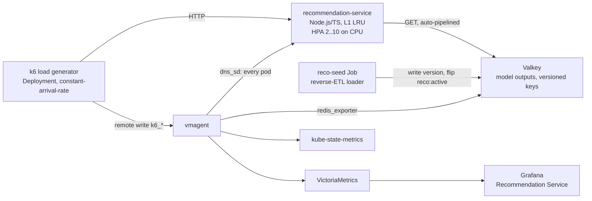

# Recommendation Autoscaling Demo (dev K3s)

A minimal, observable recommendation stack on the remote K3s development host
(`ubuntu@10.122.0.115`). It is a constant k6 load against a Node.js/TypeScript feed service backed
by Valkey. The HPA scales the service, and Grafana shows latency vs SLO, replicas, fallback
coverage, cache tiers, and the A/B experiment.



| Path | What it is |
| --- | --- |
| `kustomization.yaml` | Namespace `service-launchpad-reco`, Valkey (+ exporter), service, headless metrics Service, HPA |
| `jobs/seed-job.yaml` | Reverse-ETL load Job (`generateName`, so use `kubectl create`) |
| `load/k6-load-generator.yaml` | Always-on k6 Deployment; script from `loadtests/k6/recommendation-service.js` |
| `../monitoring/grafana-recommendation-dashboard-configmap.yaml` | Grafana dashboard |
| `../monitoring/vmagent-configmap.yaml` | `recommendation-service` (dns_sd, per pod) and `valkey` scrape jobs |

Service design and the code-level choices are documented in
[`services/recommendation-service/README.md`](../../services/recommendation-service/README.md).

## Where commands run

| Step | Machine | Target |
| --- | --- | --- |
| Build image | K3s host `ubuntu@10.122.0.115` (x86_64, has Docker) | K3s containerd image store |
| `kubectl` | Local workstation, context `dev-k3s` through an SSH tunnel | Remote K3s API |
| Fallback `kubectl` | K3s host: `sudo k3s kubectl ...` | Same cluster |

Nothing here touches GCP or production GKE, and there is no cloud cost. The workload's
steady-state footprint on the 8 vCPU / 31 GiB node is about 1 CPU and 1 GiB of requests at
the default 300 rps.

## 0. Preflight (local workstation)

The `dev-k3s` context points at `https://127.0.0.1:8443`. Open the tunnel to the K3s API
(listening on 6443 on the host) in a separate terminal and keep it running:

```bash
ssh -N -L 8443:127.0.0.1:6443 ubuntu@10.122.0.115
```

Then confirm you are talking to the K3s node and not GKE:

```bash
kubectl config use-context dev-k3s
kubectl cluster-info
kubectl get nodes -o wide          # expect one node: 6gnext, v1.36.x+k3s1
kubectl top nodes                  # metrics-server is built into K3s; the HPA depends on it
kubectl get deploy -n service-launchpad-observability   # vmagent, victoriametrics, grafana, ... Available
```

## 1. Build the image on the K3s host

The node is x86_64 and K3s uses its own containerd, not Docker's image store. Build with Docker
on the host, then import the image into K3s containerd. This is the same path
`fastapi-service:dev` used.

```bash
# local workstation: copy the service source (no node_modules/dist)
rsync -a --delete --exclude node_modules --exclude dist \
  services/recommendation-service/ ubuntu@10.122.0.115:~/service-launchpad-build/recommendation-service/

# K3s host: build, then stream the image into K3s containerd
ssh ubuntu@10.122.0.115 '
  cd ~/service-launchpad-build/recommendation-service &&
  docker build -t service-launchpad/recommendation-service:dev . &&
  docker save service-launchpad/recommendation-service:dev | sudo k3s ctr images import -
'
ssh ubuntu@10.122.0.115 'sudo k3s crictl images | grep recommendation-service'
# expect: docker.io/service-launchpad/recommendation-service   dev   <id>   ~250MB
```

The manifests use `imagePullPolicy: IfNotPresent` with the mutable `:dev` tag. After a rebuild,
pods keep the old image until they are recreated, so run
`kubectl -n service-launchpad-reco rollout restart deployment/recommendation-service`.

## 2. Update monitoring: scrape jobs and dashboard

```bash
kubectl diff -k k8s/monitoring     # review first: expect only the 4 changes below
kubectl apply -k k8s/monitoring
kubectl -n service-launchpad-observability rollout status deployment/grafana
kubectl -n service-launchpad-observability rollout status deployment/vmagent
```

Changes against the live cluster, as checked with `kubectl diff` on 2026-11-25:

- `grafana-recommendation-dashboard` ConfigMap (new) and its projected volume source on Grafana;
- `vmagent-config`: `recommendation-service` (dns_sd_configs over the headless Service) and
  `valkey` scrape jobs;
- vmagent arg `-promscrape.configCheckInterval=30s`, so future scrape-config edits apply without a
  restart.

Grafana and vmagent each roll once because their pod templates changed. Both use emptyDir, so
Grafana loses nothing that isn't provisioned from ConfigMaps, and vmagent may drop a few
seconds of scrapes.

## 3. Deploy Valkey and the service

```bash
kubectl apply -k k8s/recommendation
kubectl -n service-launchpad-reco rollout status deployment/valkey
kubectl -n service-launchpad-reco rollout status deployment/recommendation-service
kubectl -n service-launchpad-reco get pods,svc,hpa
```

Expect 1 Valkey pod (2/2 containers) and 2 service pods (HPA `minReplicas: 2`). The HPA shows
`cpu: <x>%/50%` once metrics-server has a sample (about 30-60 s). `<unknown>/50%` before that is
normal.

At this point Valkey is empty and the service is already serving the **static** fallback. That is
intentional: the feed never goes empty.

```bash
kubectl -n service-launchpad-reco port-forward svc/recommendation-service 8080:8080 &
curl -s 'localhost:8080/v1/recommendations/home?userId=u1&limit=3'
# "source":"static","modelVersion":null
```

## 4. Load the model outputs (reverse-ETL Job)

```bash
kubectl create -f k8s/recommendation/jobs/seed-job.yaml
kubectl -n service-launchpad-reco get jobs -l app.kubernetes.io/name=reco-seed
kubectl -n service-launchpad-reco logs -f -l app.kubernetes.io/name=reco-seed
# ... active version -> v2026...  (previous: none)   done in ~5-10s
```

Within `ACTIVE_VERSION_TTL_MS` (5 s), every pod switches to the new version:

```bash
curl -s 'localhost:8080/v1/recommendations/home?userId=u1&limit=3'          # "source":"personalized"
curl -s 'localhost:8080/v1/recommendations/home?userId=someone-new&limit=3' # "source":"popular" (cold start)
curl -s 'localhost:8080/v1/recommendations/product/42?limit=3'              # "source":"similar"
```

Re-running the `create` command loads a new version with zero downtime. The loader keeps the
previous version for rollback and deletes the one before it. To roll back, run:

```bash
kubectl -n service-launchpad-reco exec deploy/recommendation-service -- node dist/seed.js --rollback
```

## 5. Start the constant k6 load

```bash
kubectl -n service-launchpad-reco create configmap k6-recommendation-script \
  --from-file=recommendation-service.js=loadtests/k6/recommendation-service.js \
  --dry-run=client -o yaml | kubectl apply -f -
kubectl apply -f k8s/recommendation/load/k6-load-generator.yaml
kubectl -n service-launchpad-reco rollout status deployment/k6-load-generator
```

`create configmap --dry-run=client -o yaml | kubectl apply -f -` is an idempotent "create or
update" of a ConfigMap from a file. Kustomize cannot read files outside its own directory, which
is why this step is not in `kustomization.yaml`. If you change the script, re-run that command,
then run `kubectl -n service-launchpad-reco rollout restart deployment/k6-load-generator`.

## 6. Watch it scale

```bash
kubectl -n service-launchpad-observability port-forward svc/grafana 3000:3000
# http://127.0.0.1:3000  ->  Dashboards / Service Launchpad / Recommendation Service
```

The default load is `RATE=300`. Step it up and watch replicas follow:

```bash
kubectl -n service-launchpad-reco set env deployment/k6-load-generator RATE=1500
kubectl -n service-launchpad-reco get hpa recommendation-service -w
kubectl -n service-launchpad-reco top pods
```

What to look for in the dashboard:

| Panel | Expected behaviour |
| --- | --- |
| Offered vs served load | Lines overlap. Any `k6 dropped iterations` means the generator or service ran out of capacity. |
| CPU per pod / HPA replicas | CPU per pod rises above the 100m target line, desired replicas jump within ~15-30 s, then CPU per pod falls back towards the line. |
| Latency vs SLO | Brief p99 bump during scale-out, back under 50 ms once new pods are Ready. |
| L1 hit ratio | `similar` dips right after scale-out: new pods start with a cold in-process cache. |
| Feed source | About 80% personalized on home with the default traffic mix. |
| Distinct brands (A/B) | `diverse` noticeably above `control`. The brand cap is the treatment. |

Scale-down is deliberately slow (120 s stabilisation, then at most 50% per minute):

```bash
kubectl -n service-launchpad-reco set env deployment/k6-load-generator RATE=300
```

The resource numbers come from a local measurement: about 0.16 ms CPU per request on Apple
Silicon. Expect more on the x86 node. If the HPA never scales at 1500 rps, or scales to the max
at 300 rps, re-measure with the "CPU per pod" panel (cores / rps per pod) and adjust
`requests.cpu` or `averageUtilization`, not the load.

## 7. Failure drills

```bash
# Hot store outage: feeds keep coming (stale popular from L1, then static), latency stays low
# thanks to the circuit breaker. Watch "Feed source" and "Valkey read latency / circuit open".
kubectl -n service-launchpad-reco scale deployment/valkey --replicas=0
kubectl -n service-launchpad-reco scale deployment/valkey --replicas=1
# Valkey has no persistence, so it comes back empty: the service serves static until you reload.
kubectl create -f k8s/recommendation/jobs/seed-job.yaml

# Model cutover under load: no errors expected
kubectl create -f k8s/recommendation/jobs/seed-job.yaml
```

## Pause and cleanup

```bash
# stop the load but keep everything else
kubectl -n service-launchpad-reco scale deployment/k6-load-generator --replicas=0

# remove the whole demo workload (namespace, Valkey data, HPA, k6)
kubectl delete namespace service-launchpad-reco

# optionally revert the monitoring additions
git checkout main -- k8s/monitoring && kubectl apply -k k8s/monitoring
kubectl -n service-launchpad-observability delete configmap grafana-recommendation-dashboard

# optionally remove the image from the node
ssh ubuntu@10.122.0.115 'sudo k3s crictl rmi docker.io/service-launchpad/recommendation-service:dev'
```

## Not included (deliberately)

No Ingress (port-forward only), no persistence or replication for Valkey, no PodDisruptionBudget,
no custom-metric (RPS) autoscaling, no Protobuf schema registry. Each of these is a reasonable next
step, but none is needed to show load, latency, and scaling.
